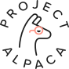
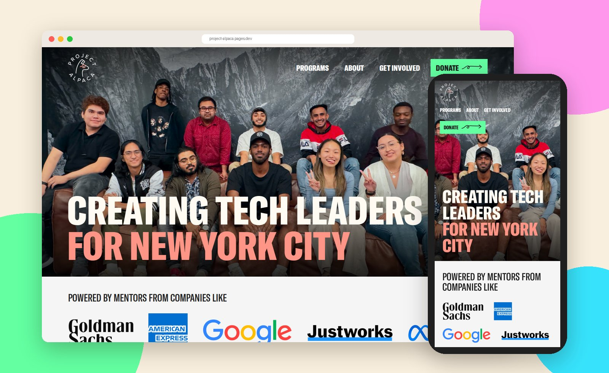
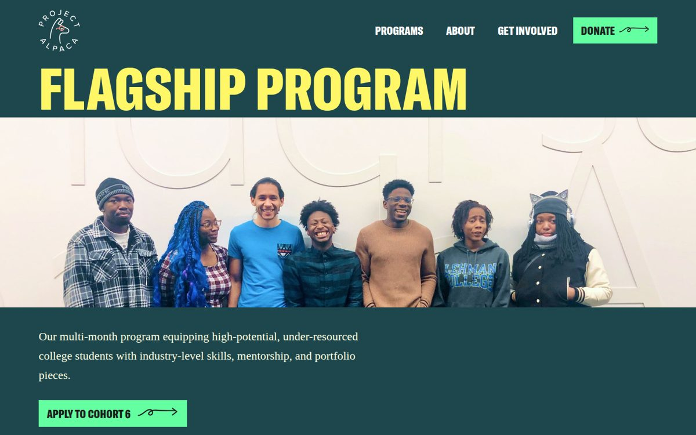
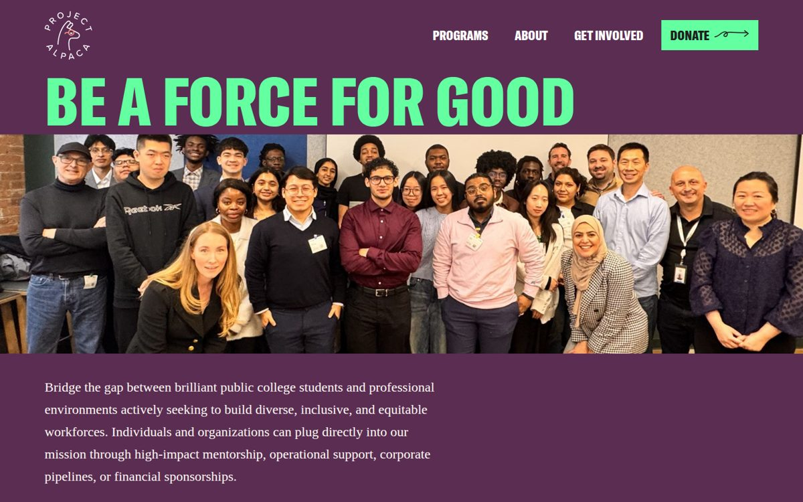
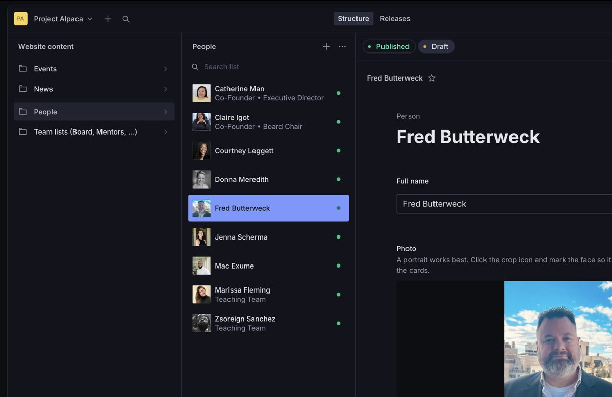
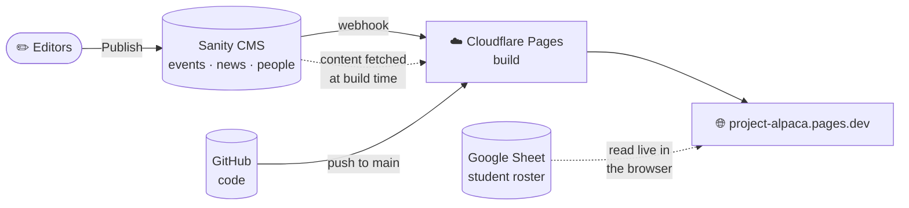

<div align="center">

<picture>
  <source media="(prefers-color-scheme: dark)" srcset="public/logo-white.svg">
  
</picture>

# Project Alpaca

**Creating tech leaders for New York City.**

The website for [Project Alpaca](https://projectalpaca.org), a grassroots 501(c)(3) helping under-resourced NYC public college students break into tech, plus the **Alpacee Directory**, where mentors, recruiters and employers meet our students.

[](https://project-alpaca.pages.dev)
[](https://projectalpaca.sanity.studio)


[](LICENSE)

<br>



</div>

---

## ✨ Highlights

| | |
|---|---|
| 🦙 **Alpacee Directory** | Every graduate as a photo card with a full profile: education, experience, projects, résumé and contact. Search by name, filter by color-coded category. |
| 🗂️ **Live from a Google Sheet** | The roster is read straight from the program's sheet: update a row, and the directory updates on the next page load. |
| ✏️ **Editable without code** | Events, news, the board, mentors, volunteers and instructors are managed in **Sanity Studio**. Click *Publish* and the site rebuilds itself in about a minute. |
| 🎨 **Pixel-matched design** | Every page is built to Studio Haven's Figma designs and checked side by side against them, down to the spacing. |
| 📱 **Responsive** | Tested from 320px phones to 1920px desktops, with no sideways scrolling. |
| 🛡️ **Resilient** | If the CMS is ever unreachable, the site still builds with its built-in content. Nothing breaks. |

## 📸 A closer look

<table>
  <tr>
    <td width="50%"><br><sub><b>Flagship Program:</b> the intensive career-prep cohort</sub></td>
    <td width="50%"><br><sub><b>Get Involved:</b> mentoring, volunteering and partnerships</sub></td>
  </tr>
  <tr>
    <td width="50%"><br><sub><b>About:</b> the team, managed in the CMS</sub></td>
    <td width="50%"><br><sub><b>Sanity Studio:</b> where the team edits content</sub></td>
  </tr>
</table>

## 🧭 How it fits together



- **Code** lives on GitHub; every push to `main` deploys.
- **Content** lives in Sanity; every *Publish* deploys. Content edits never touch the repo.
- **The directory** reads the student roster from Google Sheets directly in the browser.
- **A nightly GitHub Action** commits a snapshot of the published content, so the repo keeps a history of content changes and an up-to-date backup.

## 🚀 Getting started

**Requirements:** Node.js **22.12+** (the Studio needs it; the website works on 18+).

```bash
git clone https://github.com/jellyfishing2346/project-alpaca.git
cd project-alpaca
npm install
npm run content   # optional: pull the latest published content from Sanity
npm run dev       # http://localhost:5173
```

| Command | Where | What it does |
|---|---|---|
| `npm run dev` | repo root | Local dev server for the website |
| `npm run content` | repo root | Saves the latest published Sanity content for local dev |
| `npm run build` | repo root | Production build (fetches content, then builds); Cloudflare runs this |
| `npm run dev` | `studio/` | The editing Studio locally at http://localhost:3333 |
| `npm run deploy` | `studio/` | Publishes Studio changes to projectalpaca.sanity.studio |

## ✏️ Editing content

| To change… | Go to |
|---|---|
| Events, news, board, mentors, volunteers, instructors | **[projectalpaca.sanity.studio](https://projectalpaca.sanity.studio)** → edit → **Publish** |
| Students in the directory | The program's Google Sheet (one row per Alpacee) |
| Student headshots | `public/photos/` + `PHOTO_FILES` in `sheet.js` |
| Page text and layout | The page files (`Home.jsx`, `About.jsx`, …): a developer task |

Editor access is managed in [sanity.io/manage](https://www.sanity.io/manage) → Project Alpaca → Members.

## 🗂️ Project structure

```
project-alpaca/
├── *.jsx                      # pages: Home, Flagship, CommunityPrograms, GetInvolved,
│                              #        About, Contact, Donate, and the Alpacee Directory
├── sheet.js                   # Google Sheet → directory data
├── cms.js                     # Sanity content → pages (with built-in fallbacks)
├── scripts/fetch-content.mjs  # build step: fetch published content from Sanity
├── styles.css                 # all styling
├── public/                    # fonts, logos, photos, page images
├── snapshot/                  # nightly content snapshot (committed by a GitHub Action)
├── studio/                    # Sanity Studio (its own project and package.json)
├── docs/readme/               # images used in this README
└── DOCS.md                    # full technical documentation
```

## 📚 Documentation

**[DOCS.md](DOCS.md)** is the maintainer's handbook: architecture, the Google Sheet and its privacy rules, every page's design notes, the CMS setup (accounts, webhooks, troubleshooting), deployment, and open items.

## 💛 Credits

- **Design:** Studio Haven
- **Development:** [@jellyfishing2346](https://github.com/jellyfishing2346), volunteering for Project Alpaca
- **Photos:** Project Alpaca's students, mentors and staff

Want to support the work? **[Donate to Project Alpaca](https://projectalpaca.org/donate)**. The program is free for every student.

<div align="center">
<br>
<sub>Licensed under the <a href="LICENSE">Apache License 2.0</a>.</sub>
</div>
